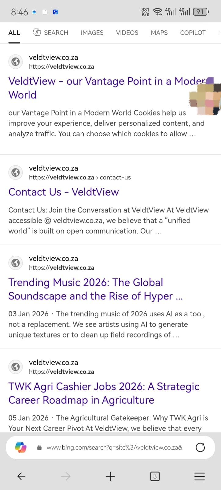
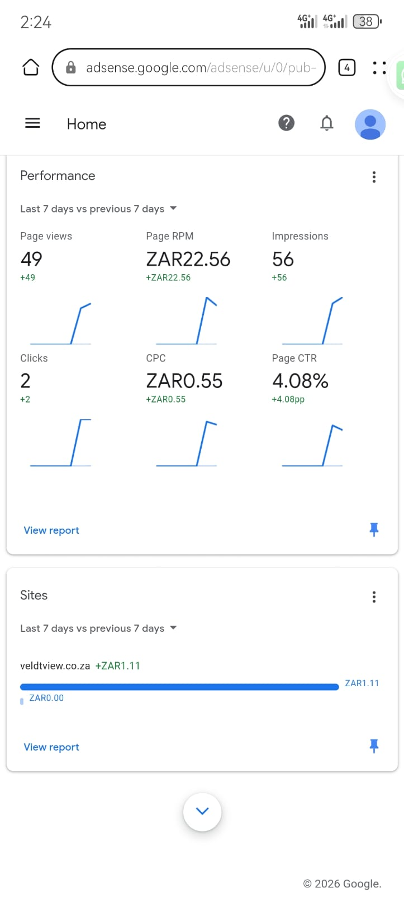

# 💼 MY PORTFOLIO
## 👋 Hi, I'm Thapelo Justin Masingi
### 🚀 Full-Stack Web Developer | Multimedia Creative | Digital Marketer

  
  
  

Passionate about building digital experiences that combine clean code, creativity, and meaningful impact.

📍 Cape Town, South Africa | 🎓 ICT Multimedia Student at CPUT | 🌱 Growing in React & Full-Stack Development

---

## 🔗 CONNECT WITH ME

💼 LinkedIn: www.linkedin.com/in/thapelo-masingi

💻 GitHub: https://github.com/thapelo262

📧 Email: 223050717@mycput.ac.za

---

## 🚀 OPEN TO

✔ Work Integrated Learning (WIL)

✔ Junior Developer Opportunities

✔ Collaboration Projects

✔ Freelance Opportunities

---

## 👨‍💻 ABOUT ME

I’m an Information and Communication Technology (ICT) student at the Cape Peninsula University of Technology (CPUT), specialising in Multimedia Applications with a strong focus on Full-Stack Development and Digital Marketing.

I enjoy creating digital solutions that solve practical problems and improve everyday experiences. My multimedia background allows me to combine design thinking with technical development to create experiences that are functional, accessible, and visually engaging.

Currently, I am actively seeking a Work Integrated Learning (WIL) opportunity where I can contribute, grow, and learn from industry professionals.

---

## 🎯 MY MISSION

To create digital experiences that combine technology and creativity while improving accessibility and solving real-world challenges.

---

## 🛠️ TECH STACK

### 💻 Development

### 🗄️ Database

### 🎨 Tools

---

## 💡 PROJECTS

### 1. Water Watch (2026)
**Role:** Frontend Developer  
**Description:** Built a water usage monitoring application featuring real-time usage graphs, interactive dashboard components, and settings panels.  
**Skills Applied:** React, Frontend Architecture, State Management, UI Design.  
#### 📸 Product Evidence

---

### 2. Urban Edge (2026)
**Role:** Full-Stack Developer & UI/UX Designer  
**Description:** Developed responsive web interfaces and architectural layouts focusing on modern web standards and user engagement.  
**Skills Applied:** Frontend Development, UI/UX Design, CSS Layouts, Responsive Design.  
#### 📸 Project Evidence

---

### 3. WorkLink (2026)
**Role:** Full-Stack Developer  
**Description:** Designed and built a platform connecting job seekers with employment opportunities through structured dashboards and interactive application components.  
**Skills Applied:** React, Component Design, User Flow Optimization.  
#### 📸 Project Evidence

---

### 4. CPUT Innovation Week / TechFest (2026)
**Role:** Campaign Designer & Developer  
**Description:** Designed "THE LAUNCHPAD" marketing campaign, social media content calendars, and promotional interfaces.  
**Skills Applied:** Campaign Strategy, Graphic Design, Content Planning.  
#### 📸 Project Evidence

---

### 5. MediTrack (2025)
**Role:** Project Lead  
**Description:** Designed a healthcare-focused platform aimed at reducing waiting times by handling appointments and administrative tasks digitally.  
**Skills Applied:** UI/UX Design, React Development, User Research, Problem Solving.  
#### 📸 Design Evidence (Figma UI/UX)
| Login Page Mockup | Dashboard Interface |
|------------------|--------------------|
|  |  |
#### ⚙️ Technical Development (React)

---

### 6. Circuit SA (2025 – Present)
**Role:** Lead Developer & Creator  
A platform designed to improve access to bursaries and learnership opportunities for students across South Africa.  
Skills: WordPress, SEO, Information Architecture, Accessibility.

---

### 7. VeldtView
**Role:** Lead Developer & Creator  
Multimedia platform optimized for accessibility, performance, and search visibility.  
#### 📸 Performance & SEO Evidence
| Search Visibility | Analytics |
|------------------|-----------|
|  |  |

---

## ✍️ AGILE PROJECT MANAGEMENT & RUBRIC EVIDENCE[cite: 4]

### 📜 1. Agile Team Charter
* **Evidence:** Established a co-created social contract defining our shared purpose, core values (transparency, accountability, collaboration), and working agreements across project workflows (such as Water Watch and WorkLink developments) to reduce friction and align daily execution[cite: 4].
* **Reflection:** Having a clear team charter kept everyone aligned from day one. It set clear behavioral boundaries and made resolving blockers much smoother since we all agreed on our communication protocols upfront.

---

### 📝 2. User Stories and Tasks
* **Evidence:** Features across Water Watch, WorkLink, and MediTrack were mapped out as user stories from the end-user perspective, then broken down into atomic tasks[cite: 4].  
  * *Example User Story:* "As a user, I want to view my monthly water usage statistics on an interactive graph so that I can track consumption patterns." -> *Tasks:* Design chart component, integrate state hooks, style dashboard grid.
* **Reflection:** Breaking requirements down into user-centric stories ensured that our development remained focused on delivering real value to the end user rather than just writing code for the sake of it.

---

### 🗂️ 3. Product Backlog
* **Evidence:** Maintained a prioritized master list of all required work, features, bug fixes, and improvements managed via Kanban boards[cite: 4].  
  * *High Priority:* Core dashboard architecture, responsive layouts, data state binding.  
  * *Medium Priority:* Advanced filtering, custom alerts, settings panels.  
  * *Low Priority:* Secondary visual animations, extended color themes.
* **Reflection:** The product backlog gave us a clear bird's-eye view of project scope. Prioritizing items early helped us manage scope creep and focus our energy on high-impact deliverables first.

---

### 🏃 4. Sprint Backlog
* **Evidence:** Created real-time, actionable sprint plans detailing specific tasks targeted for completion during iterative cycles (e.g., Sprint 1: Water Watch UI components; Sprint 2: WorkLink integration features)[cite: 4].
* **Reflection:** Sprint backlogs forced us to be realistic about our velocity. Breaking work down into short, time-boxed sprints helped us measure progress accurately and pivot quickly when technical roadblocks arose.

---

### 📖 5. Agile Logbook
* **Evidence:** Maintained an active tracking log documenting daily stand-ups, sprint planning sessions, and retrospective notes across development iterations[cite: 4].  
  * *Daily Stand-up Excerpt:* Reviewed component rendering states for Water Watch graphs; resolved prop-drilling issues.  
  * *Retrospective Note:* Improved Git branching workflows to streamline parallel feature development on multi-page applications.
* **Reflection:** Keeping a daily logbook transformed how we handled accountability. Looking back at retro notes allowed us to actively fix recurring workflow issues and improved team communication sprint over sprint.

---

## 🎥 MOCK INTERVIEW

Click below to watch:

[▶ Watch Mock Interview](0330.mp4)

---

## 🌐 LIVE PORTFOLIO

Portfolio Link:

https://thapelo262.github.io[cite: 2, 4]

---

## 📄 CURRICULUM VITAE (CV)

### PERSONAL DETAILS
👤 Full Name: Thapelo Justin Masingi  
📍 Cape Town, South Africa  
📞 0647010896  
📧 223050717@mycput.ac.za  

---

### CAREER OBJECTIVE
I’m an ICT Multimedia student specialising in Full-Stack Development and Digital Marketing seeking a Work Integrated Learning opportunity where I can contribute and continue growing professionally.

---

### CORE COMPETENCIES
✔ Full-Stack Development | ✔ UI/UX Design | ✔ SEO Optimization | ✔ Team Collaboration | ✔ Problem Solving | ✔ Responsive Design

---

### EDUCATION
**National Diploma: Information Technology**  
Cape Peninsula University of Technology  
Expected Graduation: 2026  

**National Senior Certificate**  
Michael Denga Ramabulana Secondary School  
Completed: 2021  

---

### REFERENCES
Meagan Danielle Hamman — HAMMANM@cput.ac.za  
Thurlo Dean Cicero — cicerot@cput.ac.za  

---

⭐ Thank you for visiting my portfolio  
Let's build something meaningful together 🚀

